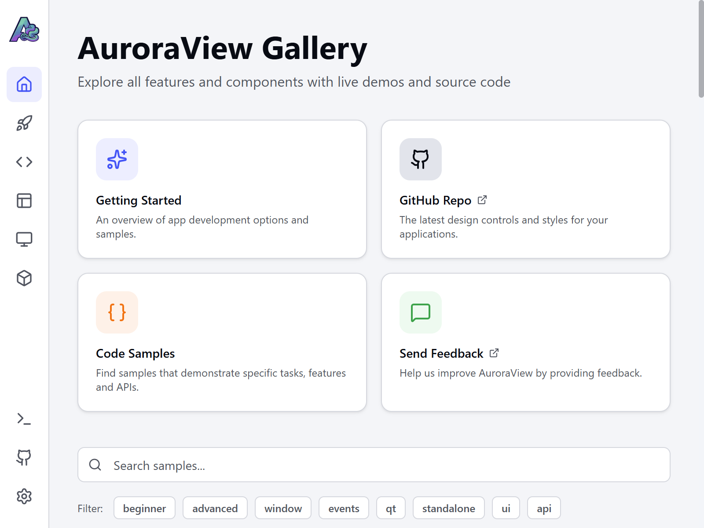

# AuroraView Gallery

[AuroraView](https://github.com/try-auroraview/auroraview) 功能、示例与组件的交互式展示应用。



Gallery 是一个完整的 AuroraView 应用：Python 宿主（`main.py` 加 `backend/` 包）驱动
React + Vite 前端（`src/`）。它是团队演示和验证框架能力的应用，独立成仓后可以脱离框架
发版节奏自行迭代。

## 目录结构

| 路径 | 说明 |
| --- | --- |
| `main.py` | 入口。启动 WebView 并注册后端 API。 |
| `backend/` | Python 宿主：进程管理、子窗口、浏览器特性、遥测、依赖检查。 |
| `src/` | React + Vite 前端。 |
| `examples/` | Gallery 展示的 AuroraView 示例，为随仓库附带的副本，见下文。 |
| `assets/icons/` | 打包时使用的应用图标。 |
| `auroraview.pack.toml` | 独立可执行程序的打包配置。 |

## 快速开始

```bash
# Python 宿主（推荐 3.11，与 auroraview.pack.toml 一致）
python -m venv .venv && source .venv/bin/activate
pip install -r requirements.txt

# 前端
npm ci
npm run build          # 生成 dist/，宿主会加载它

# 运行
python main.py
```

前端迭代需要热更新时，可在一个终端跑 `npm run dev`，另一个跑 `python main.py`；
宿主加载 `dist/`，Vite 独立提供开发服务器。

## 平台支持

Python 宿主**仅支持 Windows 与 macOS**。AuroraView 只向 PyPI 发布了 `win_amd64`
和 `macosx` wheel，从未提供 manylinux 构建，因此在 Linux 上
`pip install -r requirements.txt` 无可用版本。前端可在任意平台构建；
CI 在 Linux 上构建前端，Python 宿主作业跑在 Windows 上。

## 与框架的关系

Gallery 只通过已发布的包依赖 AuroraView：

- **Python** — PyPI 上的 [`auroraview`](https://pypi.org/project/auroraview/)。
- **前端** — npm 上的 [`@auroraview/sdk`](https://www.npmjs.com/package/@auroraview/sdk)。

仓库内不会引用本目录之外的源码。唯一的例外是 AI Agent 侧边栏：`auroraview-ai` 尚未发布，
因此除非设置 `AURORAVIEW_AI_SRC` 指向本地框架检出目录，该面板保持禁用。
`backend/__init__.py` 与 `main.py` 都会优雅处理该导入缺失。

## 随仓附带的 `examples/` 目录

`examples/` 是 `try-auroraview/auroraview` 中示例的副本，因此全新克隆无需额外配置即可运行。
若要改用上游示例进行开发，直接把宿主指向该目录即可，无需改代码：

```bash
export AURORAVIEW_EXAMPLES_DIR=/path/to/auroraview/examples
python main.py
```

从上游刷新随仓副本：

```bash
python scripts/sync_examples.py /path/to/auroraview
```

脚本会列出变更并记录同步来源的上游 commit。

## 已知缺口：打包

`auroraview.pack.toml` 已从框架仓库随迁，但 Gallery 目前还不能自行打包。
`pack` 命令位于 Rust 编写的 `auroraview-cli` 中，它需要从 `try-auroraview/auroraview`
构建，且未发布到 PyPI 或 npm。PyPI 上的 `auroraview` 命令只是一个 WebView 启动器。

在 `auroraview-cli` 发布之前，分发包仍需从框架仓库构建。进展见
[issue 跟踪](https://github.com/try-auroraview/auroraview-gallery/issues)。

## 已知债务

Gallery 在框架 monorepo 中从未被 CI 执行过 lint，拆仓时随之带来了 16 个既有的 lint 错误。

其中 4 个"未使用变量"实际是有意为之 —— 这些标识符带下划线前缀，是为保持签名对称而保留的，
因此 `eslint.config.js` 现已认可该约定。其余 12 个（`any` 类型、一处 `react-refresh`
导出、两处 `react-hooks/set-state-in-effect`）已降级为警告，保持可见但不阻塞 CI。

这些问题是真实存在且应当偿还的，但都不是本次拆仓引入的。执行 `npm run lint` 可查看当前清单。

## 开发

```bash
just install   # npm ci
just build     # 构建前端
just lint      # eslint
just check     # 构建 + lint + Python 检查
```

提交遵循 Conventional Commits。

## 许可证

[MIT](LICENSE)
